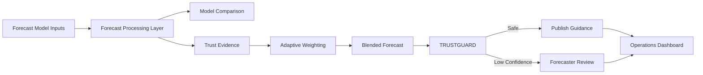

# 🌦️ SAMANVAY-WX

### Context-Aware, Extreme-Sensitive & Explainable Hybrid Forecast Intelligence

**Smart India Hackathon 2026 — Problem Statement SIH26081**

> Hybrid AI-NWP Multi-Model Forecast Blending System

**Theme:** Disaster Management  
**Category:** Software  
**Organization:** Ministry of Earth Sciences (MoES) / NCMRWF  
**Team:** Code_Raiders_01  
**Team ID:** 163542

---

## 🔗 Live Prototype

https://statuesque-cendol-312d93.netlify.app/

## 💻 GitHub Repository

https://github.com/Darky-2006/Samanvay-WX

---

# 📌 Problem Statement

Modern weather forecasting increasingly relies on multiple forecasting systems:

- Physical Numerical Weather Prediction models
- Ensemble forecasting systems
- AI/ML-based weather models

These models often produce different predictions for the same location and forecast time.

The challenge is that **no single model is consistently the best across every region, season, lead time, atmospheric regime, or weather event**.

Operational forecasters therefore face an important question:

> **For this location, weather variable, lead time and atmospheric situation, how much should each available forecast model be trusted?**

Simple averaging of forecasts does not fully solve this problem because it can:

- ignore historical model skill;
- hide model disagreement;
- smooth important extreme-weather signals;
- fail to explain why a particular model was trusted;
- produce overconfident guidance in unfamiliar situations.

---

# 💡 Our Solution — SAMANVAY-WX

**SAMANVAY-WX** is designed as a trust and decision-support layer over multiple physical, ensemble and AI weather models.

Instead of building another global weather model, SAMANVAY-WX focuses on the **model-of-models problem**:

> Learn how competing forecast models perform under different contexts and use that evidence to generate an adaptive, explainable blended forecast.

The proposed workflow is:

```text
Forecast Models
      ↓
Historical Verification
      ↓
Weather Trust Ledger
      ↓
Context-Aware Model Weights
      ↓
Adaptive Forecast Blend
      ↓
TRUSTGUARD Safety Check
      ↓
Safe → Publish Blend
Unsafe → Forecaster Review
```

The system is intended to **assist forecasters rather than replace them**.

---

# ⭐ Core Concepts

## 1. Weather Trust Ledger

The Weather Trust Ledger is designed to store evidence about how individual forecasting models perform across different contexts.

Relevant factors include:

- region / grid cell;
- forecast variable;
- lead time;
- season;
- weather regime;
- recent model bias;
- sample confidence;
- historical forecast skill.

This evidence can later be used to determine how much weight each model should receive.

---

## 2. Context-Aware Forecast Blending

Instead of assigning permanent fixed weights to forecast models, the proposed production system uses context-dependent weighting.

For example, model weights may change according to:

```text
Region
+
Lead Time
+
Season
+
Weather Regime
+
Recent Performance
+
Model Disagreement
+
Source Health
```

This allows different forecasting models to contribute differently depending on the current meteorological context.

---

## 3. Explainable Model Weights

SAMANVAY-WX is designed to expose the reasoning behind model weights rather than producing an opaque blended value.

Example reason codes include:

```text
sample_confidence_high
regime_match_active_monsoon
high_disagreement
ood_context
ai_models_gain_weight_long_lead
extreme_head_active_precip
```

This helps operational forecasters understand **why a model was trusted or why a forecast was flagged**.

---

# 🛡️ TRUSTGUARD

### Selective Forecast Blending with Deferral

A major reliability feature proposed in SAMANVAY-WX is **TRUSTGUARD**.

Most automated forecasting pipelines are designed to always produce an answer.

TRUSTGUARD instead asks:

> **Is there enough evidence to trust this blended forecast?**

The safety decision can consider factors such as:

- historical trust confidence;
- abnormal model disagreement;
- unfamiliar / out-of-distribution context;
- source health;
- blend robustness.

The intended decision flow is:

```text
Historical Trust
       +
Model Disagreement
       +
Context Novelty
       +
Source Health
       ↓
Blend Safety Assessment
       ↓
┌──────────────────┬─────────────────────┐
│ Safe             │ Uncertain / Fragile │
│ Publish Blend    │ Forecaster Review   │
└──────────────────┴─────────────────────┘
```

The objective is to avoid presenting false confidence when model evidence is weak.

---

# 🖥️ Current SIH Prototype

The current repository contains a **working demonstration prototype** of the SAMANVAY-WX operational workflow.

The prototype focuses on demonstrating:

- the user experience;
- multi-model comparison;
- adaptive model-weight visualization;
- Trust Ledger concepts;
- verification interfaces;
- TRUSTGUARD publish/defer decisions;
- forecaster review workflow;
- backend API structure.

### Important Prototype Note

The current SIH prototype uses **deterministic / synthetic demonstration data** for several forecasting, verification and trust calculations.

It is designed to demonstrate the proposed architecture and operational workflow.

The current prototype should therefore **not be interpreted as a completed operational meteorological forecasting system or as proof of measured forecast-skill improvement**.

Real historical evaluation using datasets such as WeatherBench 2 / ERA5 is part of the next validation stage.

---

# 🧭 Prototype Screens

The command-centre prototype contains the following major views:

### 🗺️ Operations Map

Provides a geographical overview of forecast information and weather-model outputs.

### 🔀 Model Comparison

Allows competing forecast models to be compared visually.

### 🧠 Trust Map

Displays the concept of context-dependent model trust and adaptive weighting.

### 📊 Verification Lab

Demonstrates how model and blended forecast performance can be evaluated.

### ⚠️ Extreme Guidance

Provides a dedicated view for high-impact weather guidance.

### 👨‍💼 Forecaster Review Queue

Demonstrates the human-in-the-loop workflow used when TRUSTGUARD decides that automated guidance should be reviewed.

### 📚 Weather Trust Ledger

Displays model-performance evidence organized by factors such as region and forecast context.

---

# 🏗️ Prototype Architecture



---

# ⚙️ Current Technology Stack

## Frontend

The current prototype uses a lightweight browser-based frontend.

Technologies include:

- HTML
- CSS
- JavaScript
- Leaflet
- Chart-based visualization
- CDN-hosted frontend dependencies

The prototype can operate with demonstration data even when the optional backend is unavailable.

---

## Backend

The repository includes an optional **FastAPI demonstration backend** written in Python.

The backend exposes prototype interfaces for the proposed SAMANVAY-WX architecture.

Available endpoints include:

```text
GET /health
GET /models
GET /blend
GET /weights
GET /ledger
GET /trustguard
GET /verification
GET /docs
```

### Backend Status

The current backend is a **prototype/demo API**.

Several returned values are generated deterministically or synthetically in order to demonstrate:

- blending;
- model weighting;
- Trust Ledger records;
- verification results;
- TRUSTGUARD decisions;
- reason codes.

Future production versions would replace these generators with real meteorological forecast and verification pipelines.

---

# 📂 Repository Structure

After cleanup, the repository should have approximately the following structure:

```text
Samanvay-WX/
│
├── index.html
├── README.md
├── .gitignore
├── START_WEBSITE.bat
│
└── backend/
    ├── main.py
    ├── requirements.txt
    ├── Dockerfile
    └── docker-compose.yml
```

---

# 🚀 Running the Prototype

## Option 1 — Open Directly

Open:

```text
index.html
```

in a modern browser such as:

- Google Chrome
- Microsoft Edge
- Firefox

Some map tiles, fonts and external frontend libraries require an internet connection.

---

## Option 2 — Run a Local Web Server

From the project root:

```bash
python -m http.server 5500
```

Then open:

```text
http://127.0.0.1:5500/
```

Windows users can also use:

```text
START_WEBSITE.bat
```

---

# 🔌 Running the FastAPI Prototype Backend

Navigate to the backend directory:

```bash
cd backend
```

Install dependencies:

```bash
pip install -r requirements.txt
```

Start FastAPI:

```bash
uvicorn main:app --reload --port 8000
```

The API will then run at:

```text
http://localhost:8000
```

FastAPI's local interactive documentation is available at:

```text
http://localhost:8000/docs
```

> This `/docs` address is a local development URL and is not currently presented as a public SIH submission link.

---

# 🐳 Docker Prototype Stack

The repository contains a Dockerfile and Docker Compose configuration for the prototype service architecture.

Run:

```bash
cd backend
docker compose up --build
```

The current Docker Compose configuration defines services for:

- FastAPI
- PostgreSQL/PostGIS
- Redis
- MinIO

These services represent the intended scalable service architecture.

The current FastAPI demonstration code does **not yet fully use all persistence and infrastructure services defined in Docker Compose**.

They provide a scaffold for the next stage of implementation.

---

# 🔬 Scientific Validation Roadmap

The next major development milestone is replacing demonstration data with real historical forecast and verification datasets.

The planned research-validation workflow is:

```text
Real Forecast Sources
        ↓
Common Grid / Unit Alignment
        ↓
Historical Forecast Archive
        ↓
ERA5 / Observation Ground Truth
        ↓
Individual Model Verification
        ↓
Equal-Mean Baseline
        ↓
Skill-Weighted Baseline
        ↓
Context-Aware Dynamic Blend
        ↓
TRUSTGUARD
        ↓
Held-Out Evaluation
```

---

# 📊 Planned Evaluation Metrics

No forecast-accuracy improvement is claimed until it is measured on held-out historical data.

Planned evaluation metrics include:

## Standard forecast skill

- RMSE
- MAE
- Bias

## Extreme-event performance

- Probability of Detection (POD)
- False Alarm Ratio (FAR)
- Critical Success Index (CSI)
- Brier Score

## TRUSTGUARD evaluation

- Risk-Coverage curve
- Deferred-case error enrichment
- Model disagreement analysis
- source-health robustness

These metrics will allow SAMANVAY-WX to be compared against baselines such as:

```text
Individual Forecast Models
Equal-Weight Ensemble Mean
Static Skill-Weighted Blend
Context-Aware SAMANVAY-WX Blend
```

---

# 🌍 Planned Real-Data Integration

The production/research version is designed to support adapters for multiple forecasting systems.

Potential sources include:

### Physical NWP / Ensemble

- NCMRWF forecasting systems
- ECMWF IFS
- Ensemble prediction systems

### AI Weather Models

- Pangu-Weather
- GraphCast
- ECMWF AIFS
- other compatible AI forecasting systems

### Verification Data

- ERA5
- operational analyses
- standardized weather benchmark datasets

The architecture is designed so that new models can eventually be added through a standardized adapter and evaluated before being given blend weight.

---

# 🛣️ Development Roadmap

## Phase 1 — SIH Prototype ✅

Current focus:

- command-centre UI;
- multi-model comparison;
- model-weight visualization;
- Trust Ledger interface;
- TRUSTGUARD workflow;
- FastAPI demonstration endpoints;
- Docker service scaffold.

---

## Phase 2 — Historical Scientific Evaluation

Planned work:

- WeatherBench 2 / ERA5 ingestion;
- India-domain subset;
- forecast-grid alignment;
- baseline evaluation;
- model skill database;
- context-conditioned verification.

---

## Phase 3 — Adaptive Blending

Planned work:

- learned contextual weights;
- regime-aware routing;
- calibrated uncertainty;
- extreme-sensitive evaluation;
- robustness testing.

---

## Phase 4 — Operational Pilot

Planned work:

- real forecast-source adapters;
- automated source-health monitoring;
- persistent Trust Ledger;
- forecaster-in-the-loop evaluation;
- automatic fallback / degraded mode.

---

## Phase 5 — Scale

Longer-term roadmap:

- additional forecast variables;
- additional regions;
- new-model onboarding;
- shadow-mode validation;
- scheduled re-verification;
- scalable model and data services.

---

# 🎯 Expected Impact

SAMANVAY-WX is designed primarily for:

> **Operational forecasters and forecast-centre analysts**

Better verified and explainable multi-model guidance can support downstream decision-making in areas such as:

- disaster management;
- agriculture;
- aviation;
- energy;
- state administration;
- extreme-weather preparedness.

The objective is not simply to make more weather information available.

The objective is to make **multi-model forecast guidance more transparent, evidence-backed and operationally trustworthy**.

---

# 🧩 Key Differentiators

SAMANVAY-WX is **not** intended to be:

- another global weather model;
- a weather chatbot;
- a static dashboard with manually fixed weights;
- a simple arithmetic average of forecasts;
- an opaque AI prediction engine.

Its proposed differentiation comes from combining:

```text
Historical Verification
+
Weather Trust Ledger
+
Context-Aware Weights
+
Explainability
+
Extreme-Sensitive Evaluation
+
TRUSTGUARD Selective Deferral
+
Human Forecaster Review
```

---

# 📚 Research Foundation

The project design is informed by established work in:

- multi-model ensemble forecasting;
- operational forecast blending;
- weather-model benchmarking;
- ensemble uncertainty;
- AI-based weather prediction;
- selective prediction and learning-to-defer.

Key references include:

### NCMRWF Multi-Model Ensemble Research

Kumar, A. et al.  
*Multi-model ensemble prediction of rainfall using neural networks during monsoon season in India.*

https://rmets.onlinelibrary.wiley.com/doi/10.1002/met.254

---

### NOAA National Blend of Models

NOAA / National Weather Service  
*National Blend of Models — Overview*

https://nomads.ncep.noaa.gov/txt_descriptions/BLEND_txt.html

Documentation:

https://blend.mdl.nws.noaa.gov/nbm-documentation

---

### WeatherBench 2

Rasp, S., Hoyer, S., Merose, A., Langmore, I., Battaglia, P., Russell, T., et al. (2024).

*WeatherBench 2: A benchmark for the next generation of data-driven global weather models.*

Journal of Advances in Modeling Earth Systems.

https://doi.org/10.1029/2023MS004019

---

### ECMWF Open Data

European Centre for Medium-Range Weather Forecasts

https://www.ecmwf.int/en/forecasts/datasets/open-data

---

### ECMWF Ensemble Mean and Spread

ECMWF Forecast User Guide

https://confluence.ecmwf.int/spaces/FUG/pages/673551056/Section+8.1.2+ENS+Mean+and+spread

---

### Learning to Defer

Verma, R. & Nalisnick, E. (2022).

*Calibrated Learning to Defer with One-vs-All Classifiers.*

Proceedings of the 39th International Conference on Machine Learning.

https://proceedings.mlr.press/v162/verma22c.html

---

### AI Weather Models and Out-of-Distribution Events

Sun, Y. Q. et al. (2025).

*Can AI weather models predict out-of-distribution gray swan tropical cyclones?*

Proceedings of the National Academy of Sciences.

https://doi.org/10.1073/PNAS.2420914122

---

# 👥 Team

### Code_Raiders_01

**Smart India Hackathon 2026**  
**Problem Statement:** SIH26081  
**Theme:** Disaster Management  
**Category:** Software

---

# ⚠️ Prototype Disclaimer

SAMANVAY-WX is currently an **SIH research and demonstration prototype**.

The present interface and FastAPI service demonstrate the proposed architecture and operational workflow using demonstration/synthetic data.

Forecast-skill improvements, extreme-event performance and reliability gains will only be reported after evaluation on appropriate held-out historical meteorological datasets.

No production-grade meteorological accuracy claim is made by the current prototype.

---

## SAMANVAY-WX

> **Verify trust. Blend intelligently. Know when to defer.**
- Backend: Railway / Render / Fly.io — `cd backend && uvicorn main:app --host 0.0.0.0 --port $PORT`

## Team

SIH 2026 · Problem Statement SIH26081 · MoES / NCMRWF
